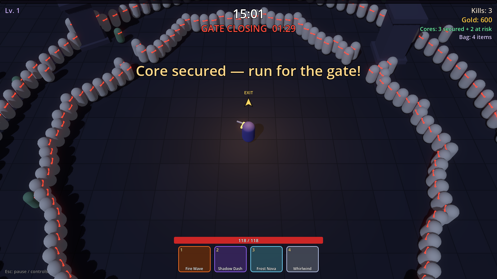
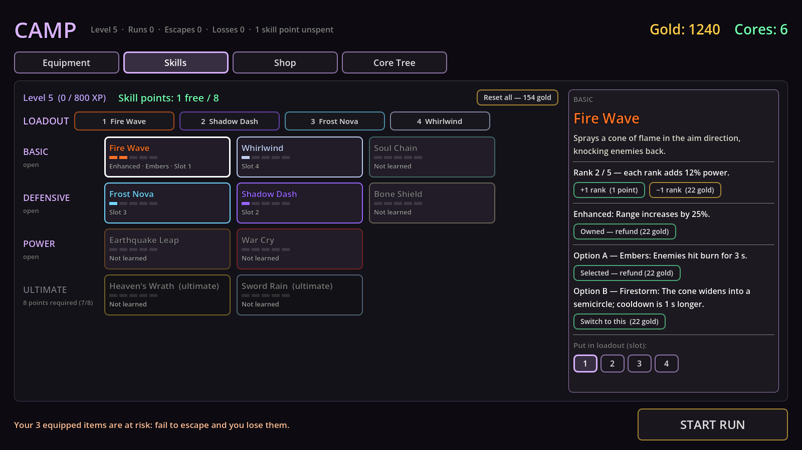

# vampiresrvvr

A survivors-like with a Diablo-style camera and an extraction twist: fight through swarms with a sword and four active powers, kill the bosses, then make it out alive with your loot — or lose it.

> **Status:** early prototype (v0.5 in progress: sound and game feel done, art next) · built with **Godot 4.7** · greybox art · working title





## The game in one run

1. **Prepare in the camp.** Equip gear, pick four powers from the skill tree, spend cores on permanent upgrades.
2. **Survive the swarm.** Your sword swings automatically at the nearest enemy; you aim and fire four powers. Level up mid-run and pick a boon each time.
3. **Take the greed decision.** Mini-bosses at minute 5 and 10 open an early exit gate somewhere on the map. Leave now with what you have, or push on?
4. **Kill the final boss and run.** At minute 15 the Bone King appears. Killing it secures your cores and opens the final gate far away; you have 90 seconds while the swarm doubles.
5. **Escape or lose it.** Stand in the gate for 3 seconds without taking damage. Escape and you keep your gold, items, cores and XP. Die (or let the gate close) and you lose all of that **and the gear you brought in**.

## Features

- **Diablo-style camera** over a 3D arena, survivors-style swarms (300+ enemies, pooled), siege waves every minute
- **Melee combat:** an automatic quarter-circle sword swing plus four active powers on keys 1–4
- **Skill tree (Diablo-style):** 10 powers across four tiers (Basic, Defensive, Power, Ultimate), 5 ranks each, an Enhanced upgrade and a choice between two options; refund points for gold or reset everything; at most one ultimate in your loadout
- **Extraction loop:** three bosses with telegraphed attacks, moving exit gates, a rough compass, a final countdown, risky vs. secured loot
- **Meta progression:** character level (XP is kept only when you escape), randomly rolled gear with rarities and affixes, a shop, a branching core tree, and a save file
- **Hades-style boons** on every level-up, including a mastery boon for each power in your loadout
- **Sound and game feel:** CC0 sound effects and music (camp, run, boss), damage numbers on every hit, particle bursts, hit-stop on big impacts, red screen edges and a heartbeat at low health; volumes, damage numbers and screen shake can be changed in Settings

## Controls

| Input | Action |
|---|---|
| WASD | Move (your character always faces the mouse) |
| Mouse | Aim powers |
| 1 · 2 · 3 · 4 | Use the powers in your loadout (hold to cast whenever ready) |
| Esc | Pause, controls, settings, withdraw from the run |
| Mouse click | Choose a boon on level-up |
| Shift+T | Debug builds only: skip ahead one minute (to reach the bosses quickly) |

## Getting started

1. Install [Godot 4.7](https://godotengine.org/download) (standard version; no C# needed).
2. Clone this repository and open `project.godot` from the Godot project manager.
3. Press **F5**. The game starts in the camp; press **Start Run**.

The save file lives in Godot's user data folder (`user://profile.json`; on macOS `~/Library/Application Support/Godot/app_userdata/vampiresrvvr/`). Delete it to start over. Settings are kept next to it in `settings.cfg`.

## Automated tests

Every system is covered by a scripted smoke test that plays the game at fixed frame rate (minutes of game time in seconds) and checks the outcome. `--no-save` keeps it away from your real save file.

```bash
godot --headless --path . --fixed-fps 60 res://tests/smoke_test.tscn -- --no-save --scenario=systems
```

| Scenario | What it checks |
|---|---|
| `systems` | 4 minutes of play with every power and boon pick; every sound file, the music, damage numbers and particles |
| `death` | dying loses the equipped gear, then the camp loads |
| `early_exit` | escape through the early gate: gold, a core, an item and XP are kept |
| `final_exit` | kill all bosses and escape through the final gate |
| `timeout` | the final gate closes: only the secured cores survive |
| `boss_view` | all three bosses and their attacks |
| `hub` | shop, gear, core tree, skill tree rules, saving, migrating older saves |
| `powers --set=A`…`F` | six loadouts that together run all 20 options of the 10 powers |

A failing scenario exits with code 1. Drop `--headless` and add `--screenshots=/absolute/path` to save screenshots (add `--real-health` for a normal health bar).

## Project layout

```
scenes/       main (run), hub (camp), player, enemies, world
scripts/
  abilities/  the ten powers (one script each) and their base class
  skills/     skill tree definitions
  player/     movement, sword swing, health, shield, loadout
  enemies/    enemies, bosses, spawner, enemy and boss types
  run/        run director (bosses, gates, countdown, loot) and the exit gate
  meta/       items, item generator, stats, core tree
  hub/        camp screen and its tabs
  ui/         HUD, level-up, pause, settings and result screens
  fx/         ground effects, particle bursts, damage numbers
  autoload/   Game (run-wide references), Profile (save data), Settings, Audio
resources/    enemy and boss tuning (.tres, editable in the Inspector)
audio/        sound effects, music and their credits
tools/        Python scripts that build the sound files (need ffmpeg)
tests/        the smoke test
GDD.md        the game design document
```

Balance values live in the Inspector (`EnemySpawner`, `RunDirector`, `Chests`, `Player`) and in a few data scripts; the [design document](GDD.md#11-prototype-notes-v05) lists where each one is, including the sound mix.

## Roadmap

- **v0.5:** ~~sound and game feel~~ (done), then real art: stylized low-poly models with animations, toon shading, environment and lighting
- Balance pass from playtesting
- New characters and power pools unlocked with cores

See [GDD.md](GDD.md) for the full design.

## Credits

Sound effects and music are CC0 releases from OpenGameArt (Kenney, artisticdude, rubberduck, qubodup, yd, Juhani Junkala); a few sounds are synthesized by `tools/synth_sfx.py`. See [audio/CREDITS.md](audio/CREDITS.md) for every file and its source.
